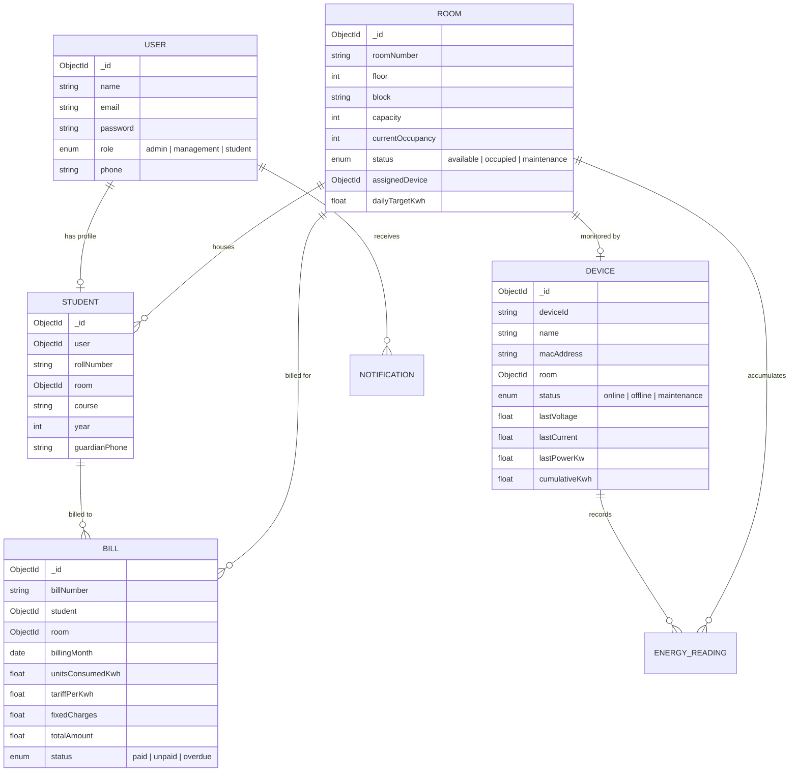

# HostelWatt – Comprehensive Technical Manual & System Architecture Guide

---

## 1. Executive Summary & Project Overview

**HostelWatt** is an end-to-end Smart Hostel Energy Management and Automated Billing platform designed for universities, colleges, and residential institutions. It solves the critical operational challenges of traditional hostel power management:
- **Uncontrolled electricity wastage**: Students leaving fans, lights, heaters, and air coolers running in vacant rooms.
- **Flat-rate or unfair billing**: Dividing total hostel electricity equally among students regardless of actual individual consumption.
- **Submetering complexity**: Inability to monitor room-level power consumption in real time without expensive industrial SCADA systems.
- **Billing disputes & manual errors**: Paper-based meter readings and human calculation mistakes.

HostelWatt bridges IoT hardware (ESP32 smart energy nodes) with modern web engineering (React, Tailwind CSS, Node.js, Express, MongoDB Atlas, Socket.IO, and MQTT) to provide **sub-second telemetry, automatic anomaly detection, tiered tariff calculations, and one-click PDF invoice generation**.

---

## 2. High-Level System Architecture

HostelWatt operates as a distributed multi-tier architecture spanning hardware sensors, an IoT communication pipeline, a real-time event-driven backend, and a reactive client dashboard.

```mermaid
flowchart TD
    subgraph IoT_Hardware["IoT Hardware Layer"]
        ESP32_1["ESP32 Node (Room 101)<br/>Voltage / Current / Power"]
        ESP32_2["ESP32 Node (Room 102)<br/>Sensors: PZEM-004T / ACS712"]
        SIM["ESP32 Virtual Simulator<br/>(Built-in Load Generator)"]
    end

    subgraph IoT_Transport["IoT Ingestion Layer"]
        MQTT_B["Embedded Aedes MQTT Broker<br/>Port 1883"]
        MQTT_C["Internal MQTT Client<br/>Topic: hostelwatt/+/telemetry"]
    end

    subgraph Backend_Core["HostelWatt Node.js & Express Backend"]
        SRV["Express REST API & HTTP Server<br/>Port 5000"]
        AUTH["JWT Auth & Role-Based Middleware<br/>(Admin, Management, Student)"]
        ALERT_ENG["Anomaly & Surge Detection Engine<br/>Threshold & Vacancy Checks"]
        BILL_ENG["Automated Billing Calculation Engine<br/>Tariff, Fixed Charges & Tax"]
        SOCKET_IO["Socket.IO WebSocket Server<br/>Real-Time Broadcast Engine"]
    end

    subgraph Database_Layer["Database Layer"]
        MONGO[("MongoDB Atlas Cloud Database<br/>Mongoose ODM with Indexes")]
    end

    subgraph Frontend_Clients["Frontend Applications (React + Vite)"]
        ADMIN_UI["Admin & Management Dashboard<br/>Live Telemetry, CRUD, Invoicing"]
        STUDENT_UI["Student Self-Service Portal<br/>Usage Analytics, PDF Bills, Alerts"]
    end

    ESP32_1 -->|MQTT Publish| MQTT_B
    ESP32_2 -->|MQTT Publish| MQTT_B
    SIM -->|Simulated Telemetry| MQTT_B

    MQTT_B -->|Subscribe| MQTT_C
    MQTT_C -->|Raw Telemetry Stream| ALERT_ENG
    ALERT_ENG -->|Save Readings| MONGO
    ALERT_ENG -->|Trigger Anomalies| SOCKET_IO

    SRV <--> MONGO
    BILL_ENG <--> MONGO
    SRV --> SOCKET_IO

    SOCKET_IO <==>|WebSockets / Polling| ADMIN_UI
    SOCKET_IO <==>|WebSockets / Polling| STUDENT_UI
    ADMIN_UI <==>|REST API (JWT)| SRV
    STUDENT_UI <==>|REST API (JWT)| SRV
```

---

## 3. IoT Hardware & Communication Architecture

### 3.1. Physical ESP32 Hardware Integration
Each hostel room is assigned an **ESP32 Energy Measurement Node** equipped with:
- **Microcontroller**: ESP32 Dual-Core Tensilica Xtensa 32-bit LX6 with integrated Wi-Fi (802.11 b/g/n).
- **Sensors**: PZEM-004T v3.0 (AC energy monitor with dedicated metering chip measuring Voltage, Current, Active Power, Power Factor, and Cumulative Energy) or ACS712 Hall-effect current sensor + ZMPT101B voltage transformer.
- **Relay Module** (Optional): 30A solid-state or electromagnetic relay for remote cutoff in case of critical electrical surges or unpaid dues.

### 3.2. MQTT Protocol & Topic Topology
HostelWatt features an **embedded Aedes MQTT Broker** running on port `1883`, eliminating the requirement of installing external brokers like Mosquitto.

#### Topic Structure:
| Topic Pattern | Direction | Payload Schema | Description |
|---|---|---|---|
| `hostelwatt/rooms/{roomId}/telemetry` | ESP32 → Server | JSON (voltage, current, powerKw, energyKwh, powerFactor) | High-frequency telemetry stream (every 5–10s). |
| `hostelwatt/devices/{deviceId}/status` | ESP32 → Server | JSON (deviceId, status: 'online'/'offline', ip, rssi) | Device heartbeat and network connectivity telemetry. |
| `hostelwatt/devices/{deviceId}/control` | Server → ESP32 | JSON (relayState: 'ON'/'OFF', resetCounter: boolean) | Remote actuation and hardware configuration. |
| `hostelwatt/alerts/surge` | Server → All | JSON (roomId, powerKw, threshold, timestamp) | System-wide surge broadcast. |

#### Sample Telemetry Payload:
```json
{
  "deviceId": "ESP32_R101",
  "roomNumber": "101",
  "voltage": 230.4,
  "current": 1.25,
  "powerKw": 0.288,
  "powerFactor": 0.95,
  "cumulativeKwh": 142.85,
  "timestamp": "2026-11-20T01:40:00.000Z"
}
```

### 3.3. Built-in ESP32 Hardware Simulator (`simulatorService.js`)
To enable full system testing without requiring physical microcontrollers on a test bench, HostelWatt includes a built-in IoT simulator:
- **Realistic Circadian Load Modeling**: Simulates diurnal consumption patterns (low nighttime baseload, morning peak, daytime minimum, and evening student peak).
- **Appliance Signatures**: Simulates laptops (65W), ceiling fans (75W), study lamps (15W), electric kettles (1500W), and iron/coolers (2000W).
- **Interactive Surge Injection**: The Admin API exposes a route (`POST /api/devices/simulator/trigger-surge`) that deliberately injects an abnormal spike (>3.8 kW) into a designated room to test real-time alerts.

---

## 4. Backend Engine & Architectural Modules

The backend is built with **Node.js, Express.js, and Mongoose ODM**.

### 4.1. Core Server Modules & Directories
```
backend/
├── src/
│   ├── config/
│   │   ├── db.js                # MongoDB Atlas connection with resilient retry logic
│   │   └── socket.js            # Socket.IO WebSocket broadcast engine
│   ├── controllers/
│   │   ├── authController.js        # Registration, login, JWT issuance, profile updates
│   │   ├── studentController.js     # Student profile & room allocation management
│   │   ├── roomController.js        # Hostel rooms, occupancy, and node assignment
│   │   ├── deviceController.js      # ESP32 node registry and simulator controls
│   │   ├── energyController.js      # Room-wise telemetry, analytics, historical graphs
│   │   ├── billingController.js     # Bill generation, calculations, payment updates
│   │   ├── notificationController.js# System alerts, vacancy warnings, mark-as-read
│   │   ├── reportController.js      # Aggregate metrics, energy consumption exports
│   │   └── settingsController.js    # Tariff rates, thresholds, currency config
│   ├── middleware/
│   │   ├── authMiddleware.js    # JWT verification (`protect`) and RBAC (`authorize`)
│   │   └── errorMiddleware.js   # Global error handling and 404 responses
│   ├── models/
│   │   ├── User.js              # Credentials, roles (admin, management, student)
│   │   ├── Student.js           # Roll number, course, room reference, guardian info
│   │   ├── Room.js              # Room number, floor, capacity, assigned device
│   │   ├── Device.js            # MAC address, firmware, live voltage, current, kWh
│   │   ├── EnergyReading.js     # Timeseries telemetry records
│   │   ├── Bill.js              # Billing periods, units consumed, tariff breakdown
│   │   ├── Notification.js      # Surge, offline, vacancy, and billing alerts
│   │   └── Settings.js          # Global tariffs, surge kW thresholds, fixed charges
│   ├── routes/                  # Express REST route definitions
│   ├── scripts/
│   │   └── seed.js              # Comprehensive database seeder
│   ├── services/
│   │   ├── mqttBroker.js        # Embedded Aedes MQTT broker
│   │   ├── mqttClient.js        # Node.js MQTT subscriber & parser
│   │   ├── simulatorService.js  # Virtual hardware simulator
│   │   ├── alertService.js      # Real-time surge, vacancy & offline detector
│   │   └── billingService.js    # Automated bill computation logic
│   └── server.js                # Entry point, HTTP & WebSocket bootstrapping
├── .env.example
└── package.json
```

### 4.2. Database Entity Relationship Diagram (ERD)



### 4.3. Automated Electricity Billing Mathematical Model
HostelWatt computes bills based on exact energy consumption data recorded by the ESP32 smart meter over a designated billing cycle.

$$\text{Energy Cost} = \text{Units Consumed (kWh)} \times \text{Tariff Rate (₹/kWh)}$$

$$\text{Subtotal} = \text{Energy Cost} + \text{Fixed Maintenance Charge}$$

$$\text{Tax Amount} = \text{Subtotal} \times \left(\frac{\text{Configured Tax Rate \%}}{100}\right)$$

$$\mathbf{\text{Total Bill Amount}} = \text{Subtotal} + \text{Tax Amount}$$

*For shared rooms (e.g., 2 students in Room 101), the billing engine automatically divides the room's total units consumed equally among all registered active occupants.*

### 4.4. Intelligent Anomaly Detection Engine (`alertService.js`)
1. **High Consumption / Surge Alerts**: If the active power of any room exceeds `ABNORMAL_POWER_THRESHOLD_KW` (default `3.5 kW`), the system instantly generates an emergency alert and broadcasts it over WebSockets to the Admin Dashboard.
2. **Vacant Room Power Wastage Alert**: If a room has `currentOccupancy == 0` (or during vacation intervals) and power draw exceeds `VACANT_POWER_THRESHOLD_KW` (default `0.15 kW`), an alert flags potential forgotten fans, lights, or unauthorized room access.
3. **Hardware Heartbeat & Offline Detection**: Every 30 seconds, a background worker inspects `device.lastSeen`. If no packet has arrived within 60 seconds, the node is flagged `offline` and maintenance staff are alerted.

---

## 5. Frontend Architecture & Features

The frontend is constructed using **React 18 with Vite and Tailwind CSS**, emphasizing a modern, professional, responsive UI with crisp typography, soft cards, and high contrast.

```
frontend/
├── src/
│   ├── api/
│   │   └── client.js            # Axios client with JWT interceptor & base URL resolver
│   ├── components/
│   │   ├── Badge.jsx            # Dynamic status badges (Paid, Unpaid, Online, Offline)
│   │   ├── InvoiceModal.jsx     # Visual invoice modal with jsPDF instant PDF export
│   │   ├── LoadingSpinner.jsx   # Consistent loading state indicator
│   │   ├── Modal.jsx            # Reusable modal container
│   │   ├── Navbar.jsx           # Global header with live IoT status & notifications
│   │   ├── Sidebar.jsx          # Role-based adaptive navigation bar
│   │   └── StatCard.jsx         # KPI summary cards with trend indicators
│   ├── context/
│   │   ├── AuthContext.jsx      # Authentication session state & token management
│   │   └── SocketContext.jsx    # Socket.IO connection & real-time telemetry bus
│   ├── layouts/
│   │   ├── AdminLayout.jsx      # Scaffold for Admin & Hostel Management roles
│   │   └── StudentLayout.jsx    # Scaffold for Student Portal with guarded routing
│   ├── pages/
│   │   ├── Login.jsx            # Unified login with 1-click demo accounts
│   │   ├── Register.jsx         # New student registration
│   │   ├── admin/
│   │   │   ├── AdminDashboard.jsx     # Live KPIs, telemetry charts, device statuses
│   │   │   ├── StudentManagement.jsx  # Student registry & room allocation
│   │   │   ├── RoomManagement.jsx     # Room occupancy & smart node binding
│   │   │   ├── DeviceManagement.jsx   # ESP32 nodes, signal strength, surge generator
│   │   │   ├── EnergyMonitoring.jsx   # Submetering graphs, comparisons, peak hours
│   │   │   ├── BillingManagement.jsx  # 1-click batch bill generation & payment toggles
│   │   │   ├── AlertsAndNotifications.jsx # Live audit log of electrical events
│   │   │   ├── Reports.jsx            # Monthly consumption summaries & Excel/CSV export
│   │   │   └── SettingsPage.jsx       # Tariffs, thresholds, and hostel metadata
│   │   └── student/
│   │       ├── StudentDashboard.jsx   # Student summary, today's kWh, estimated bill
│   │       ├── MyEnergyUsage.jsx      # Daily, weekly, and monthly consumption charts
│   │       ├── MyBills.jsx            # Bill list with visual invoice modal & PDF download
│   │       ├── PaymentHistory.jsx     # Payment ledger with transaction IDs & receipts
│   │       ├── StudentNotifications.jsx # Personal alerts & hostel energy notices
│   │       └── StudentProfile.jsx     # Personal profile, assigned room, and guardian details
│   ├── App.jsx                  # React Router v6 tree with role-based auth guards
│   ├── index.css                # Tailwind CSS entry with custom styling
│   └── main.jsx                 # Application bootstrapping
```

---

## 6. Detailed Walkthrough of User Portals

### 6.1. Admin Portal (`role: 'admin'`)
- **Executive Dashboard**: Displays real-time aggregate metrics including total hostel power demand (kW), total energy consumed today (kWh), active smart meters online, and uncollected billing dues. Contains real-time Recharts showing live power fluctuations.
- **Student Management**: Add, view, edit, and assign students to specific rooms. Real-time validation prevents assigning students to over-capacity rooms.
- **Room Management**: Room occupancy tracker with room categories (Single, Double, AC, Non-AC), floor allocations, and ESP32 device binding.
- **Device Management**: Lists all physical/simulated ESP32 nodes, their firmware versions, MAC addresses, signal status, and live electrical parameters (Voltage, Amperage, Active kW, Power Factor). Includes a **"Trigger Electrical Surge"** simulator button for live testing.
- **Automated Billing Management**:
  - Filter bills by month, room, or payment status.
  - **"Generate Monthly Bills"** button: Automatically calculates kWh consumed by every room over the preceding month and generates individual itemized bills.
  - Toggle payment status (`Unpaid` → `Paid`).
  - View and download formal PDF invoices.
- **Alerts & Notifications**: Real-time event log alerting administrators to abnormal consumption, appliance left running in vacant rooms, or disconnected smart meters.
- **Reports & Analytics**: Visual charts breaking down energy usage across floors, blocks, and peak hours. Supports CSV data export for institutional accounting.
- **System Settings**: Configure electricity tariff per kWh (e.g., ₹8.50), fixed hostel maintenance fee, tax rate, and power surge threshold limits.

### 6.2. Hostel Management Portal (`role: 'management'`)
- Specially tailored for wardens, caretakers, and facility managers.
- Access to occupancy monitoring, live room-by-room power tracking, and vacancy anomaly alerts.
- View billing records without administrative system settings modification access.

### 6.3. Student Portal (`role: 'student'`)
- **Student Dashboard**: Shows personal room consumption today (kWh), current month estimated electricity bill, daily budget gauge, and assigned room specifications.
- **My Energy Usage**: Interactive analytics with daily, weekly, and monthly bar/area charts showing exact times of peak consumption.
- **My Bills & Invoices**: Itemized table of all monthly bills. Clicking **"View Invoice"** opens a professional receipt with:
  - Institutional header and billing metadata.
  - Room number and Roll number.
  - Initial and final meter readings.
  - Total kWh consumed $\times$ tariff rate.
  - One-click **"Download PDF"** button powered by client-side `jsPDF`.
- **Payment History**: Transparent transaction log detailing payment dates, payment modes, and confirmation reference codes.
- **Profile**: Student information, room allotment date, course, and registered guardian contact details.

---

## 7. Security, Authentication & Data Protection

1. **Password Security**: Passwords are salted and hashed using **bcryptjs** (10 salt rounds) before persistence to MongoDB.
2. **Stateless Authentication**: Protected API endpoints require a **Bearer JWT Token** issued upon successful login and signed with a cryptographic secret. Tokens expire after 7 days.
3. **Role-Based Access Control (RBAC)**: An `authorize(...roles)` middleware validates user role claims before allowing access to administrative routes.
4. **Input Sanitization**: Request bodies are sanitized and validated using `express-validator` to protect against NoSQL injection and parameter pollution.
5. **CORS Policy**: Configured to restrict or allow authorized frontend domains (`http://localhost:5000`, `http://localhost:5173`, Netlify) with credential support.

---

## 8. Verification & Demo Credentials

The database comes pre-seeded with complete sample records across all roles:

| Role | Email Address | Password | Details |
|---|---|---|---|
| **System Admin** | `admin@hostelwatt.com` | `admin123` | Full administrative control across all settings & billing |
| **Hostel Warden / Staff** | `manager@hostelwatt.com` | `manager123` | Operational access to rooms, occupancy, and alerts |
| **Student 1** | `rahul@hostelwatt.com` | `student123` | Assigned to Room 101 (Double room with active ESP32 node) |
| **Student 2** | `priya@hostelwatt.com` | `student123` | Assigned to Room 102 (Single room with active ESP32 node) |
| **Student 3** | `amit@hostelwatt.com` | `student123` | Assigned to Room 201 |

---

## 9. How to Run & Operate Locally

### Prerequisites
- Node.js (v18 or higher)
- npm (v9 or higher)
- Internet connection (to communicate with the MongoDB Atlas cloud cluster)

### Execution Steps
1. Open your terminal in the project directory:
   ```bash
   cd c:\Users\mehta\Desktop\Kanishak\backend
   ```
2. Start the unified server:
   ```bash
   node src/server.js
   ```
3. Open your browser and navigate to:
   ```
   http://localhost:5000
   ```
4. Click any of the **One-Click Demo Accounts** on the login page to access the application.

---

## 10. Cloud Deployment Topology

HostelWatt is architected for cloud-native zero-maintenance deployment:
- **Frontend**: Deployed as a single-page application (SPA) on **Netlify** with global CDN edge caching and redirect rules (`_redirects` for client-side routing).
- **Backend**: Configured for continuous integration via GitHub (`Blackdrg/hostelwatt-backend`) and deployable to container platforms like **Render**, **Railway**, or **Fly.io**.
- **Database**: Hosted on **MongoDB Atlas** with automatic automated backups, global replica sets, and encrypted connections (`mongodb+srv://...`).
